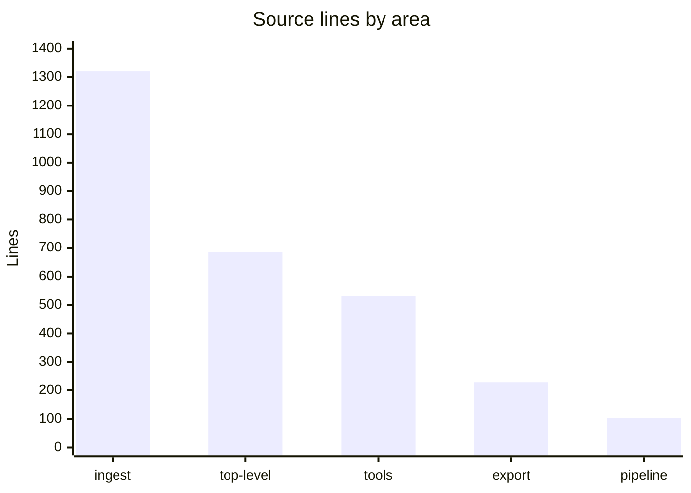

# By the numbers

Data collected on 2026-10-10.

## Size

| Area | Lines | Files |
| --- | --- | --- |
| Source, `src/purestrata` | 2,868 | 20 Python files |
| Tests, `tests` | 913 | 11 files, 79 passing in 0.66 s |
| Site, `site/index.html` | 341 | 1 bilingual EN/JA page |
| README | 224 | 1 |
| CI, `.github/workflows/{ci,pypi,pages}.yml` | 76 | 3 |

Average source file size is 143.4 lines. Lines by area of `src/purestrata`, current tree:

"Top-level" is the six modules at the package root: `cli.py` (187), `types.py` (122), `mcp_server.py` (118), `search.py` (110), `corpus.py` (78), `__init__.py` (70). Ingestion alone is 46% of the source.

## Activity

All six commits landed on one calendar day, 2026-10-10 Japan Standard Time (UTC+9):

| Commit | Time (JST) | Subject |
| --- | --- | --- |
| `1785130` | 08:09:01 | Initial release: open data layer for manufacturing AI |
| `f1c4778` | 08:46:12 | Add PyPI trusted publishing workflow on version tags |
| `63fc38b` | 14:42:56 | Add STEP ingestion, drawing geometry search, call CLI, and MCP setup guide |
| `74d9d8f` | 14:45:52 | Release 0.2.0 |
| `4e04b6a` | 14:57:23 | Add bilingual GitHub Pages intro site and deploy workflow |
| `65a4fd2` | 15:01:14 | Fix tool-count docstring and ignore local wiki artifacts |

The full history fits inside 6 hours 52 minutes. Both tagged releases, `v0.1.0` (on `f1c4778`) and `v0.2.0` (on `74d9d8f`), ship the same day, 5 hours 59 minutes apart; the v0.2.0 release commit follows its feature commit by 2 minutes 56 seconds.

The initial commit contains the entire codebase, so "most changed" splits into files touched by the initial release versus files touched after it. Files edited more than once:

| File | History |
| --- | --- |
| `README.md` | 202 lines at release, +26/−8 with the STEP feature, +4 with the site |
| `src/purestrata/tools/schemas.py` | +209 at release, +42 with the STEP feature, 1-line docstring fix last |
| `src/purestrata/__init__.py` | 3 commits: release, STEP feature, version bump |
| `src/purestrata/tools/executor.py` | +185 at release, +83 with the STEP feature |
| `src/purestrata/ingest/cad.py` | +253 at release, +34/−1 with the STEP feature |
| `tests/test_mcp.py` | +60 at release, +92/−4 with the STEP feature |
| `tests/test_tools.py` | +110 at release, +51/−5 with the STEP feature |

The largest single commit is `63fc38b`: +1,156 lines across 19 files in one push, including the STEP reader (383 lines), `docs/MCP.md` (152), the geometry module (94), the `search_drawings` wiring, the `call` CLI command, and a sample STEP assembly (42). Files written once and never edited again include `site/index.html`, `docs/MCP.md`, and `examples/data/cad/bracket_assy_mk3.step`.

## Bot-attributed commits

All 6 of 6 commits (100%) carry the trailer `Co-authored-by: factory-droid[bot] <138933559+factory-droid[bot]@users.noreply.github.com>`. The only human identity in the log is "DK", author and committer on every commit.

The 100% is a lower bound on AI-assisted work, not a measure of its extent. Inline tool assistance leaves no trace in git, so the trailers prove only what was attributed, never what was not. What they do show is that every commit in this one-day-old repository was prepared with the bot credited as co-author.

## Complexity

Largest source modules:

| Module | Lines |
| --- | --- |
| `src/purestrata/ingest/manual.py` | 404 |
| `src/purestrata/ingest/step.py` | 383 |
| `src/purestrata/ingest/cad.py` | 286 |
| `src/purestrata/tools/executor.py` | 268 |
| `src/purestrata/tools/schemas.py` | 250 |
| `src/purestrata/export/finetune.py` | 214 |

The deepest import chain runs four modules: `tools/executor.py` imports `corpus.py`, which imports `search.py`, which imports `types.py`. `types.py` imports no other `purestrata` module, so the chain bottoms out there.

Other counts that shape the package:

- 10 exported tools, identical across 5 integration surfaces (MCP, OpenAI, Anthropic, Python, CLI): `list_corpus`, `search_documents`, `get_safety_notices`, `get_procedure`, `search_parts`, `list_drawings`, `get_drawing`, `search_drawings`, `search_failure_cases`, `get_failure_case`
- 6 record kinds: `manual_section`, `safety_notice`, `procedure`, `part_record`, `drawing`, `failure_case`
- 2 optional extras, `pdf` (`pypdf>=4.0`) and `mcp` (`mcp>=1.2`), and 0 required dependencies; the `[project]` table in `pyproject.toml` declares no `dependencies` key at all
