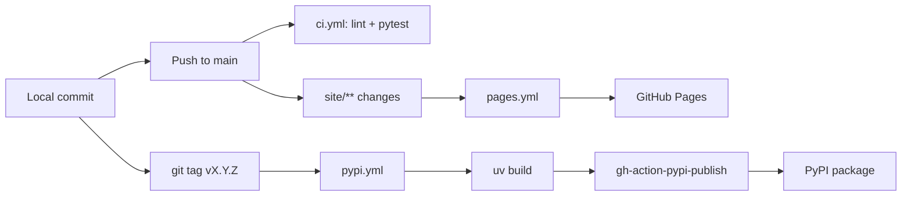

# Deployment

PureStrata is a library plus a static site. Three things ship from this repository, and none of them is a running service:

| Artifact | Where it goes | Driven by |
| --- | --- | --- |
| Python package `purestrata` | PyPI | `.github/workflows/pypi.yml` |
| Bilingual one-pager | GitHub Pages (`https://daikiito-dk.github.io/PureStrata/`) | `.github/workflows/pages.yml` |
| Test signal | GitHub Actions check on every push and PR | `.github/workflows/ci.yml` |

A corpus never leaves the machine that built it unless the user moves it. There is no hosted ingestion service, no API to call, and no server component that PureStrata operates. `purestrata serve` starts an MCP server over stdio inside whichever process the user launched; it is a local child process, not a deployment.

## Release path: tag to PyPI

Releases are tag-driven. `.github/workflows/pypi.yml` triggers on `push` with tags matching `v*`, and its `publish` job requests `permissions: id-token: write` so it can authenticate to PyPI with OIDC trusted publishing instead of a stored token.



The job runs these steps in order:

1. `actions/checkout@v4`, then `astral-sh/setup-uv@v5`.
2. `uv sync --all-extras` — the dev group plus both optional extras, so PDF and MCP code paths import successfully.
3. `uv run ruff check src tests`.
4. `uv run pytest`.
5. `uv build`, which drives hatchling to build the wheel (`packages = ["src/purestrata"]`) and the sdist (`include = ["src", "tests", "examples", "README.md", "LICENSE"]`).
6. `pypa/gh-action-pypi-publish@release/v1` with `packages-dir: dist/`.

Steps 3 and 4 repeat what CI already did. That is deliberate: a tag can be pushed on a commit that never passed CI, and the publish job refuses to build or upload anything if lint or tests fail.

Trusted publishing means there is no `PYPI_API_TOKEN` in repository secrets. The registered owner of the PyPI project is the GitHub owner, so the OIDC identity that the job presents is the identity PyPI expects.

### Version bump ritual

The version string lives in two files that must agree:

- `pyproject.toml` -> `version = "0.2.0"`
- `src/purestrata/__init__.py` -> `__version__ = "0.2.0"`

The order that keeps everything consistent:

1. Edit both files to the new version.
2. Run `uv lock` so `uv.lock` records the new project version.
3. Commit the three files together, as the release commits did (`f1c4778` added the workflow; the tags `v0.1.0` and `v0.2.0` both exist in the repository).
4. Create an annotated tag: `git tag -a v0.2.1 -m "v0.2.1"`.
5. Push the tag: `git push origin v0.2.1`. This is the only action that publishes.

A published version is immutable on PyPI. If a release is wrong, the fix is a new patch version, not a re-upload.

## CI gate

`.github/workflows/ci.yml` runs on pushes to `main` and on every pull request:

```bash
uv sync --all-extras
uv run ruff check src tests
uv run ruff format --check src tests
uv run pytest
```

The same commands are available locally through the `Makefile`: `make setup`, `make lint`, `make test`. `make lint` runs the check and the format check; `make demo` builds `examples/corpus` by ingesting the bundled sample data. Details are on [Testing](how-to-contribute/testing.md).

## Site deployment

`site/index.html` is a single self-contained bilingual page with no build step. `.github/workflows/pages.yml` publishes it:

- Trigger: push to `main` filtered on `site/**` and the workflow file itself, plus `workflow_dispatch` for manual runs. A commit that touches only `src/` does not redeploy the site.
- Permissions: `contents: read`, `pages: write`, `id-token: write`.
- Concurrency: group `pages` with `cancel-in-progress: true`, so a newer site commit supersedes an in-flight deploy.
- Steps: `actions/configure-pages@v5`, `actions/upload-pages-artifact@v3` with `path: site`, `actions/deploy-pages@v4` in the `github-pages` environment.

Because the artifact is the `site/` directory itself, anything committed there is public. There is no draft or preview URL.

## How users deploy it themselves

The library is consumed, not hosted. Three install shapes are documented in `README.md`:

```bash
pip install purestrata                 # core, no third-party runtime dependencies
pip install "purestrata[pdf]"          # adds pypdf for PDF manuals
pip install "purestrata[mcp]"          # adds mcp for the stdio server
```

For MCP clients, `uvx` runs it without a persistent install. Client config:

```json
{
  "mcpServers": {
    "purestrata": {
      "command": "uvx",
      "args": ["--from", "purestrata[mcp]", "purestrata", "serve", "--corpus", "/abs/path/to/corpus"]
    }
  }
}
```

`purestrata serve --corpus <dir>` loads the corpus and runs the server on stdio. Whatever client connects receives tool results containing corpus content; see [Security](security.md) and [MCP server](features/mcp-server.md).

For OpenAI-compatible endpoints, `examples/api_tool_use.py` sends the tool schemas to a user-configured base URL and executes the returned calls locally. `README.md` documents the environment variables for that path.

The Python API needs no server at all:

```python
executor = ps.ToolExecutor(ps.Corpus.load("corpus/"))
hits = executor.execute("search_failure_cases", {"query": "spindle vibration", "top_k": 3})
```

## No staging environment

There is no staging or pre-production tier, because there is nothing to stage. The product surface is (1) an immutable PyPI artifact that users pin by version, and (2) a static page deployed straight from `main`. "Production" is the published package `purestrata==0.2.0`. The closest thing to a canary is that the release job re-runs the full test suite and lint before building, so the artifact that reaches users is the one that passed.

For what each artifact declares about itself, see [Configuration reference](reference/configuration.md) and [Dependencies](reference/dependencies.md).
