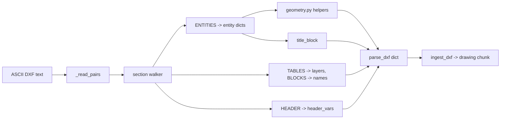

# DXF drawings

Active contributors: DK

## Purpose

`src/purestrata/ingest/cad.py` reads ASCII DXF and produces one `drawing` chunk per file. It extracts the metadata an LLM workflow needs from a 2D drawing: layers, entity inventory, text annotations, title-block fields, geometric bounds, and circle diameters. Binary DXF is out of scope; the module docstring states that limit.

## Key abstractions

| Abstraction | Location | What it does |
| --- | --- | --- |
| `parse_dxf(path)` | `src/purestrata/ingest/cad.py` | Walks the file and returns a metadata dict, never raising on partial data |
| `ingest_dxf(path, doc_id=None)` | `src/purestrata/ingest/cad.py` | Calls `parse_dxf`, builds the text body, returns one `drawing` chunk |
| `_read_pairs(path)` | `src/purestrata/ingest/cad.py` | Converts the file into `(group_code, value)` pairs |
| `_compute_bounds(entities)` | `src/purestrata/ingest/cad.py` | Min/max x and y over `LINE`, `CIRCLE`, `ARC`, `TEXT`, `MTEXT` |
| `_drawing_text(...)` | `src/purestrata/ingest/cad.py` | Builds the searchable text from the parsed summary |
| `_clean_text(value)` | `src/purestrata/ingest/cad.py` | Strips MTEXT escapes and braces, then runs `clean_inline` |
| `_norm_key(key)` | `src/purestrata/ingest/cad.py` | Lowercases a title-block label into a metadata key |
| `_UNIT_CODES` | `src/purestrata/ingest/cad.py` | Maps `$INSUNITS` codes to `mm`, `cm`, `m`, `inches`, `feet`, `unitless` |
| `size_from_bounds`, `summarize_circular_features`, `parse_diameter_callouts` | `src/purestrata/ingest/geometry.py` | Shared derivations covered in [CAD ingestion](index.md) |

## How it works

### Group-code pair reader

`_read_pairs` splits the file on lines and treats them in pairs: an integer group code followed by its value. `i` advances by two per pair. A line that will not parse as an integer is skipped with `i += 1`, which survives stray blank lines and truncated values. The result is a flat `list[tuple[int, str]]` that the rest of the module walks linearly.

### Section walker

`parse_dxf` iterates the pairs with a small state machine. Code `0` starts a new record; `SECTION` sets a flag so the next code `2` names the section, and `ENDSEC` clears it. Inside `ENTITIES`, code `0` opens an entity dict with `type`, `layer`, `texts`, `points`, and `radius`. Inside `TABLES`, a `LAYER` marker opens a layer dict. Inside `BLOCKS`, `BLOCK` records a block name. Inside `HEADER`, code `9` sets the current variable and later codes are stored as `header_vars["$INSUNITS:70"]` style keys via `setdefault`, so the first value wins.

Per-entity codes are collected while the entity is current:

| Code | Meaning in `src/purestrata/ingest/cad.py` |
| --- | --- |
| `8` | Layer name |
| `1`, `3` | Text payload, appended to `texts` |
| `10`-`13` and `20`-`23` | Point coordinates, stored in `points` |
| `40` | Radius for `CIRCLE` and `ARC` |

Codes `1` and `3` are both captured because long MTEXT is split across them.

### Circular features and callouts

Entities of type `CIRCLE` with a radius contribute `(radius * 2, layer)` to a list that `summarize_circular_features` collapses into one entry per distinct diameter, with a count and the sorted layers that carry it. The same pass over `TEXT` and `MTEXT` entities builds `text_annotations`; `parse_diameter_callouts` then scans those strings with `_CALLOUT_RE` to pick up nominals and ISO fit classes such as `H7` or `h6`. A callout is matched through `DIA`, `Ø`, `⌀`, `φ`, `Φ`, or AutoCAD's `%%C` control code, so the sample's `BORE DIA 25 H7` yields `{"nominal": 25.0, "fit": "H7", "text": "BORE DIA 25 H7"}`.

### Title block

Text entities are cleaned with `_clean_text`, which turns `\P` paragraph escapes into spaces, removes braces, and defers whitespace collapsing to `clean_inline` in `src/purestrata/pipeline/clean.py`. Every cleaned annotation is matched against `_TITLE_FIELD_RE`, a `KEY: VALUE` pattern accepting Latin labels up to 40 characters. Matches are stored with `_norm_key`, so `DWG NO:` becomes `dwg_no`. `setdefault` keeps the first occurrence, which mirrors how title blocks are drafted. The sample file yields `dwg_no=BRK-0042-A`, `part_no=BRK-0042`, `title=MOUNTING BRACKET MK3`, `material=SS400`, and `scale=1:2`; the full-width colon form `：` is accepted too.

### Bounds and size

`_compute_bounds` accumulates x and y values by entity type. `LINE` contributes both endpoints from codes `(10, 20)` and `(11, 21)`. `CIRCLE` and `ARC` contribute `center ± radius` on each axis, which is a conservative box for an arc but never smaller than the drawing. `TEXT` and `MTEXT` contribute their insertion point, not their glyph extent. The function returns `None` when no usable coordinates exist, and `size_from_bounds` then returns `None` as well. For `examples/data/cad/bracket_mk3.dxf` the bounds are `{"min_x": 0.0, "min_y": 0.0, "max_x": 100.0, "max_y": 80.0}` and the size is `{"width": 100.0, "height": 80.0}`. Header variables like `$EXTMIN`/`$EXTMAX` are not used for bounds; entity geometry is the source.

### The drawing text

`_drawing_text` assembles the string that BM25 indexes, joined with periods: `Drawing <id> (<file>)`, then the title-block fields that exist (`Title`, `Material`, `Scale`, `Revision`, `Part`), `Units:`, the layer names, `Entities:` with per-type counts, `Circular features:` via `describe_circular_features`, `Fits:` for callouts that carry a fit, and up to 10 annotations after `Annotations:`. The 10-annotation cap keeps record text bounded while every annotation still lands in `metadata["text_annotations"]` for exact lookups.

### Entry contract

`ingest_dxf(path, doc_id=None)` derives `doc_id` from the file stem when the caller passes none, picks `drawing_id` from `title_block.dwg_no`, then `part_no`, then `derive_doc_id`, and returns a single `Chunk` of kind `DRAWING` with `locator="drawing"`. Because chunk ids are `sha1(doc_id::kind::locator)[:12]`, re-ingesting the same file replaces the previous record rather than adding one. The sample path produces `doc_id="bracket_mk3"`.

## Integration points

- Exported from `src/purestrata/__init__.py` and `src/purestrata/ingest/__init__.py`; the CLI command is `ingest-dxf` in `src/purestrata/cli.py`.
- Metadata feeds `search_drawings` and `list_drawings` in `src/purestrata/tools/executor.py`; see [LLM tools](../llm-tools.md).
- Text lands in the BM25 index built by `src/purestrata/search.py`, so annotations, layer names, and materials are all reachable by free-text query.
- Diameter handling is shared with the STEP adapter through `src/purestrata/ingest/geometry.py`; see [STEP models](step.md).

## Entry points for modification

| Change | Where |
| --- | --- |
| Capture another entity type | Entity dict creation and the per-code branch in `parse_dxf` |
| Capture another coordinate code | `_X_CODES` and `_Y_CODES` in `src/purestrata/ingest/cad.py` |
| Add a unit code | `_UNIT_CODES` in `src/purestrata/ingest/cad.py` |
| Widen title-block recognition | `_TITLE_FIELD_RE` and `_norm_key` in `src/purestrata/ingest/cad.py` |
| Change what search can match | `_drawing_text` in `src/purestrata/ingest/cad.py` |

## Key source files

| File | Role |
| --- | --- |
| `src/purestrata/ingest/cad.py` | Full DXF adapter: pair reader, section walker, bounds, text |
| `src/purestrata/ingest/geometry.py` | Diameter grouping, callout regex, unit conversion, size |
| `src/purestrata/pipeline/clean.py` | `clean_inline`, applied to all extracted text |
| `src/purestrata/types.py` | `Chunk`, `DRAWING`, `derive_doc_id`, `new_chunk` |
| `tests/test_ingest_cad.py` | Asserts units, layers, counts, title block, bounds, and chunk text |
| `examples/data/cad/bracket_mk3.dxf` | Sample drawing used by the tests and the corpus fixture |
