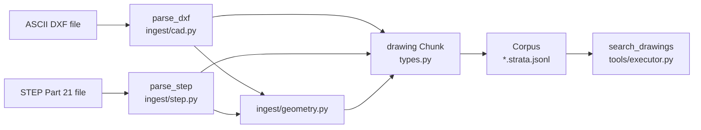

# CAD ingestion

Active contributors: DK

## Purpose

PureStrata reads two CAD formats with no third-party library: ASCII DXF drawings in `src/purestrata/ingest/cad.py` and STEP models (ISO 10303-21, AP203/AP214/AP242) in `src/purestrata/ingest/step.py`. Each source file becomes exactly one `drawing` chunk whose metadata follows the same key contract, so one tool with one set of filters covers both formats. The numbers and phrases that matter to retrieval are computed by `src/purestrata/ingest/geometry.py`, which both adapters import.

## Key abstractions

| Abstraction | Location | What it does |
| --- | --- | --- |
| `ingest_dxf(path, doc_id=None)` | `src/purestrata/ingest/cad.py` | Returns one `drawing` chunk with locator `drawing` |
| `ingest_step(path, doc_id=None)` | `src/purestrata/ingest/step.py` | Returns one `drawing` chunk with locator `model` |
| `MM_PER_UNIT`, `to_mm` | `src/purestrata/ingest/geometry.py` | Converts a native-unit diameter to millimetres |
| `summarize_circular_features` | `src/purestrata/ingest/geometry.py` | Groups `(diameter, layer)` pairs into one entry per diameter |
| `parse_diameter_callouts` | `src/purestrata/ingest/geometry.py` | Extracts `DIA` / `Ø` / `⌀` / `φ` / `Φ` / `%%C` callouts and ISO fits |
| `size_from_bounds` | `src/purestrata/ingest/geometry.py` | Turns bounds into `width`/`height`, plus `depth` when z exists |
| `feature_diameter_mm` | `src/purestrata/ingest/geometry.py` | Filter value: millimetres when known, otherwise native units |
| `describe_circular_features` | `src/purestrata/ingest/geometry.py` | Renders features into the chunk text, for example `diameter 25 mm x1` |
| `DRAWING`, `new_chunk` | `src/purestrata/types.py` | Record kind and the deterministic chunk id |

### Shared metadata contract

Both adapters build the `metadata` dict for their single chunk. Keys present in both:

| Key | Type | DXF source | STEP source |
| --- | --- | --- | --- |
| `format` | `str` | `"dxf"` | `"step"` |
| `drawing_id` | `str` | `title_block.dwg_no`, then `part_no`, then `derive_doc_id` | root product id, then `derive_doc_id` |
| `file_name` | `str` | `Path(path).name` | `Path(path).name` |
| `units` | `str` | `$INSUNITS` code via `_UNIT_CODES` | `_detect_units` over unit entities |
| `size` | `dict \| None` | `size_from_bounds` of entity bounds | `size_from_bounds` of point bounds |
| `circular_features` | `list[dict]` | `CIRCLE` radii grouped by diameter | `CYLINDRICAL_SURFACE` radii grouped by diameter |
| `diameter_callouts` | `list[dict]` | Text annotations matched by `_CALLOUT_RE` | Always `[]` |
| `layers` | `list[dict]` | `TABLES`/`LAYER` entries with name and color | Always `[]` |
| `title_block` | `dict[str, str]` | Normalized `KEY: VALUE` annotations | Product `id` and `name` of the root |
| `bounds` | `dict \| None` | `min_x`, `min_y`, `max_x`, `max_y` | Same, plus `min_z`/`max_z` when points are 3D |
| `entity_counts` | `dict[str, int]` | Counter of entity types | Counter of entity types, 25 most common |

Each `circular_features` entry is `{"diameter": float, "diameter_mm": float | None, "count": int, "layers": [str]}`. Each `diameter_callouts` entry is `{"nominal": float, "fit": str | None, "text": str}`.

DXF adds `per_layer_counts`, `text_annotations`, and `blocks`. STEP adds `header`, `products`, `assembly`, and `entity_total`. Fits are a 2D annotation, so STEP records keep an empty `diameter_callouts` list rather than dropping the key.

## How it works

Each adapter reads its file as UTF-8 with `errors="replace"`, because CAD exports are frequently not clean UTF-8. The parse step is pure: it returns a plain dict and never raises on partial data, so a file the parser only half understands still produces a chunk. `ingest_*` then derives `doc_id` with `derive_doc_id(path)` when the caller passes none, builds a human-readable text body, and wraps it in a `Provenance` with locator `drawing` (DXF) or `model` (STEP). The chunk text is what BM25 ranks later, and the metadata is what filters select on.

`drawing_id` resolution differs by format on purpose. A DXF carries its identity in the title block, so `dwg_no` wins there. A STEP file carries identity in the product entities, so the root product id wins. Both fall back to the stem of the file name.

## Integration points

- `src/purestrata/__init__.py` re-exports `ingest_dxf`, `ingest_step`, and `parse_step`, so the Python API and the CLI share the same entry points.
- `src/purestrata/cli.py` registers `ingest-dxf` and `ingest-step` in its command table, both writing into `--out corpus/`.
- Ingested chunks land in `src/purestrata/corpus.py` as `*.strata.jsonl` lines and are indexed by `src/purestrata/search.py`; see [Corpus](../../primitives/corpus.md) and [Full-text search](../full-text-search.md).
- The `search_drawings` tool in `src/purestrata/tools/executor.py` filters on exactly this metadata: `min_diameter`/`max_diameter` use `feature_diameter_mm` over `circular_features`, `fit` compares against `diameter_callouts[].fit`, `material` matches `title_block.material` or the chunk text, and `cad_format` matches `metadata["format"]`. The tool never touches `layers` or `bounds`. See [LLM tools](../llm-tools.md) for the tool surface and [Reference](../../reference/index.md) for the parameter definitions.
- `src/purestrata/ingest/geometry.py` is shared code, so a change there moves DXF and STEP behavior together.

## Entry points for modification

| Change | Where |
| --- | --- |
| Support a new DXF entity type | `parse_dxf` in `src/purestrata/ingest/cad.py`, plus `_compute_bounds` if it contributes geometry |
| Support a new STEP entity or attribute chain | `parse_step` in `src/purestrata/ingest/step.py` |
| New unit string or conversion factor | `MM_PER_UNIT` and `_CALLOUT_RE` in `src/purestrata/ingest/geometry.py` |
| New metadata key on drawing records | Both `ingest_dxf` and `ingest_step` metadata dicts, then `search_drawings` if it should be filterable |
| Different indexed text | `_drawing_text` in `src/purestrata/ingest/cad.py` and `_model_text` in `src/purestrata/ingest/step.py` |

## Key source files

| File | Role |
| --- | --- |
| `src/purestrata/ingest/cad.py` | ASCII DXF reader, `parse_dxf`, `ingest_dxf`, drawing text |
| `src/purestrata/ingest/step.py` | Part 21 reader, `parse_step`, `ingest_step`, model text |
| `src/purestrata/ingest/geometry.py` | Unit table, feature grouping, callout parsing, size helpers |
| `src/purestrata/types.py` | `Chunk`, `Provenance`, `DRAWING`, `new_chunk`, `derive_doc_id` |
| `src/purestrata/tools/executor.py` | `search_drawings` and `list_drawings` consuming the metadata |
| `examples/data/cad/bracket_mk3.dxf` | 2D sample drawing, `BRK-0042-A`, SS400, Ø25 H7 bore |
| `examples/data/cad/bracket_assy_mk3.step` | 3D sample assembly, `BRK-ASSY-01`, Ø25 x1 and Ø9 x2 |
| `tests/test_ingest_cad.py`, `tests/test_ingest_step.py` | Behavior locks for both adapters and the geometry helpers |

Deep dives: [DXF drawings](dxf.md) and [STEP models](step.md).
