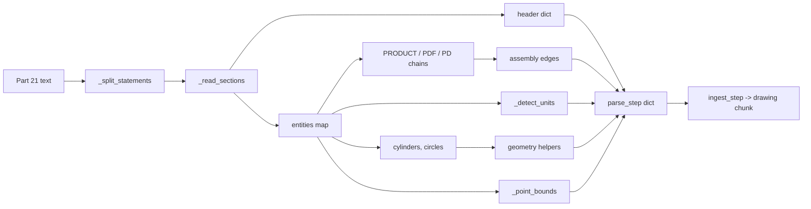

# STEP models

Active contributors: DK

## Purpose

`src/purestrata/ingest/step.py` reads STEP 3D models (ISO 10303-21, schemas AP203, AP214, AP242) with standard-library code only and emits one `drawing` chunk per file. It extracts what LLM workflows need from a model: the file header, product names, the assembly tree with quantities, length units, cylindrical features, and point bounds. It does not evaluate B-rep topology, so bounds come from `CARTESIAN_POINT` entities and can slightly exceed the solid, as the module docstring notes.

## Key abstractions

| Abstraction | Location | What it does |
| --- | --- | --- |
| `parse_step(path)` | `src/purestrata/ingest/step.py` | Returns the metadata dict for one Part 21 file |
| `ingest_step(path, doc_id=None)` | `src/purestrata/ingest/step.py` | Wraps `parse_step` into one `drawing` chunk with locator `model` |
| `_split_statements(text)` | `src/purestrata/ingest/step.py` | Splits on `;` outside string literals and `/* */` comments |
| `_split_args(text)` | `src/purestrata/ingest/step.py` | Splits an argument list on top-level commas |
| `decode_string(raw)` | `src/purestrata/ingest/step.py` | Decodes `''` escapes and `\X2\`, `\X4\`, `\X\` encodings |
| `_read_sections(path)` | `src/purestrata/ingest/step.py` | Returns the `HEADER` dict and `{id: (type, args, raw)}` entities |
| `_header_info(header)` | `src/purestrata/ingest/step.py` | Normalizes `FILE_DESCRIPTION`, `FILE_NAME`, `FILE_SCHEMA` |
| `_detect_units(entities)` | `src/purestrata/ingest/step.py` | Reads length units from SI or conversion-based unit entities |
| `_point_bounds(points)` | `src/purestrata/ingest/step.py` | Min/max over all `CARTESIAN_POINT` coordinates |
| `_Ref` | `src/purestrata/ingest/step.py` | `int` subclass marking an `#id` entity reference |
| `summarize_circular_features`, `size_from_bounds` | `src/purestrata/ingest/geometry.py` | Shared derivations, see [CAD ingestion](index.md) |

## How it works

### Statement and argument splitting

`_split_statements` scans character by character with an `in_string` flag, so a `;` inside a quoted value does not end a statement, and a `/* ... */` comment is skipped to its `*/` or to end of file. Any trailing buffer is kept as a final statement. `_split_args` then walks an argument list tracking parenthesis depth and string state, splitting only on commas at depth zero; nested typed values such as `(LENGTH_UNIT()NAMED_UNIT(*)SI_UNIT(.MILLI.,.METRE.))` stay intact. Commas inside `'...'` string literals, which appear in Japanese part descriptions, are not separators.

### String decoding

`decode_string` strips the surrounding quotes, replaces the doubled `''` escape with a single quote, then applies three code-page expansions in order: `_X2_RE` for `\X2\...\X0\` runs decoded as UTF-16-BE, `_X4_RE` for 32-bit codes as UTF-32-BE, and `_X_RE` for single-byte `\X\hh` sequences decoded as latin-1. That is how `examples/data/cad/bracket_assy_mk3.step` stores the Japanese product name `位置決めピン` as `\X2\4F4D7F6E6C7A308130D430F3\X0\`, which the test suite asserts round-trips. A final `\\\\` to `\` replacement handles escaped backslashes.

### Sections and entities

`_read_sections` runs over the statements with a `mode` marker. `HEADER`, `DATA` or `DATA(`, and `ENDSEC` switch modes. In header mode, `NAME(...)` statements are stored in an uppercase-keyed dict with parsed arguments. In data mode, `_ENTITY_RE` captures the `#id` and body; a simple `TYPE(args)` body is stored as `(TYPE, args, raw)`, and anything else, notably the complex unit entities, is stored as `("COMPLEX", [], body)` with the raw text kept for later string matching. `_parse_value` handles `$` and `*` as `None`, quoted strings through `decode_string`, `#n` as `_Ref`, parentheses as nested lists, enumerations such as `.MILLI.` as raw strings, and numbers as floats. Unknown typed values such as `NAMED_UNIT(*)` fall through unchanged.

### Products and the assembly tree

Product identity is spread over four entity types, so `parse_step` links them in two passes. The first pass collects `PRODUCT` entities into `products[id] = {id, name, description}`, and maps each `PRODUCT_DEFINITION_FORMATION` (including `_WITH_SPECIFIED_SOURCE`, the `_PDF_TYPES` set) to its product reference at argument index 2. The second pass maps each `PRODUCT_DEFINITION` (including `_WITH_ASSOCIATED_DOCUMENTS`, the `_PD_TYPES` set) to the product of its formation. `NEXT_ASSEMBLY_USAGE_OCCURRENCE` then yields parent and child product ids from arguments 3 and 4, counted in a `Counter` keyed by the `(parent, child)` pair, so each duplicate occurrence becomes one edge with a quantity. For the sample assembly, `BRK-ASSY-01` contains `BRK-0042` x1 and `PIN-0110` x2.

Root products are the products that never appear as a child. If the file has no assembly relations at all, every product is a root. `ingest_step` takes the first root, falling back to the first product and then to the derived document id, as the drawing id.

### Units

`_detect_units` scans raw entity text for `COMPLEX` entities whose body contains `LENGTH_UNIT`. It first looks for conversion-based units, matching `CONVERSION_BASED_UNIT('INCH'` or `'FOOT'` to return `inches` or `feet`. Otherwise it matches `SI_UNIT(<prefix>,.METRE.)` and maps `.MILLI.` to `mm`, `.CENTI.` to `cm`, and `$` (no prefix) to `m`. Anything else in a file with no length unit entity returns `unspecified`, which makes `to_mm` return `None` and leaves diameters in native units.

### Cylinders, bounds, and counts

Cylindrical features come from `CYLINDRICAL_SURFACE` entities, where argument 2 is the radius, so `radius * 2` is the diameter; per-feature layer strings are empty because STEP has no layer annotation. When a file has no cylindrical surface entity, the pass repeats over `CIRCLE` radius values instead. `_point_bounds` ignores points whose coordinates are not all floats, takes min/max on x and y, and adds `min_z`/`max_z` only when at least one point has a third coordinate. Because these are point extents rather than the evaluated solid, a model's reported `size` can be marginally larger than its nominal material size. `entity_counts` holds the 25 most common entity type names and `entity_total` the full count.

### Entry contract

`ingest_step(path, doc_id=None)` returns a single `DRAWING` chunk with locator `model`, so its chunk id is `sha1(doc_id::drawing::model)[:12]`. `metadata["diameter_callouts"]` is `[]` by construction and `metadata["layers"]` likewise, which keeps the key contract identical to the DXF adapter. `_model_text` writes the indexable body: `3D model <id> (<file>)`, title, header description and schema, units, the product list with descriptions, the assembly as `<parent> contains <child> xN`, cylindrical features via `describe_circular_features`, and the size as joined dimensions.

## Integration points

- Exported as `ingest_step` and `parse_step` from `src/purestrata/__init__.py`; the CLI command is `ingest-step` in `src/purestrata/cli.py`.
- Metadata is consumed by `search_drawings` and `list_drawings` in `src/purestrata/tools/executor.py`, where `cad_format="step"` selects these records; see [LLM tools](../llm-tools.md).
- Assembly edges and product names land in the chunk text, so queries such as a Japanese part name or an assembly id are matched by `src/purestrata/search.py`.
- Diameter normalization and size derivation are shared with the DXF adapter through `src/purestrata/ingest/geometry.py`; see [DXF drawings](dxf.md).

## Entry points for modification

| Change | Where |
| --- | --- |
| Support another product or definition subtype | `_PDF_TYPES` and `_PD_TYPES` in `src/purestrata/ingest/step.py` |
| Support another unit prefix or conversion | `_SI_PREFIX_UNITS` and `_CONVERSION_UNITS` in `src/purestrata/ingest/step.py` |
| Add a decoded string encoding | `decode_string` and its regex constants in `src/purestrata/ingest/step.py` |
| Change which entities define bounds | The `points` collection and `_point_bounds` in `src/purestrata/ingest/step.py` |
| Raise or lower the entity histogram cap | `entity_counts` in `parse_step` in `src/purestrata/ingest/step.py` |

## Key source files

| File | Role |
| --- | --- |
| `src/purestrata/ingest/step.py` | Full STEP adapter: splitting, decoding, product and assembly chains, units, bounds |
| `src/purestrata/ingest/geometry.py` | `summarize_circular_features`, `size_from_bounds`, `describe_circular_features` |
| `src/purestrata/pipeline/clean.py` | `clean_inline`, applied to decoded header and product strings |
| `src/purestrata/types.py` | `Chunk`, `DRAWING`, `derive_doc_id`, `new_chunk` |
| `tests/test_ingest_step.py` | Asserts header fields, Japanese names, assembly quantities, features, bounds, decoding |
| `examples/data/cad/bracket_assy_mk3.step` | Sample assembly, AP214, `BRK-ASSY-01`, 100x80x6 mm |
