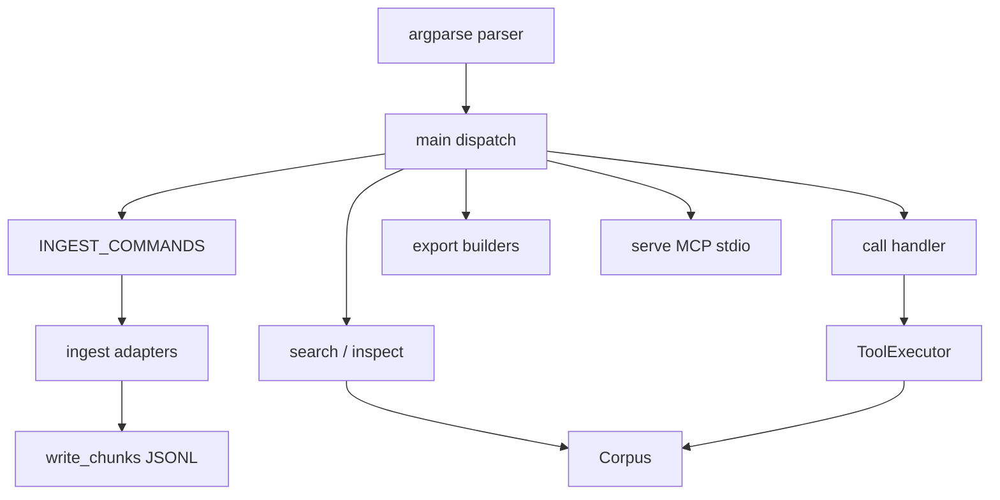

# Command line interface

Active contributors: DK

## Purpose

The `purestrata` command is the packaged entry point for the whole pipeline: ingest source files into a corpus, search and inspect it, print tool schemas, export fine-tuning datasets, run a single tool call locally, and start the MCP server. `src/purestrata/cli.py` is a thin layer over the library, `python -m purestrata.cli` behaves identically to the console script, and `make demo` runs the full sequence over the bundled sample data.

## Key abstractions

| Abstraction | File | Notes |
| --- | --- | --- |
| `_build_parser` | `src/purestrata/cli.py` | argparse tree; one block per subcommand |
| `main` | `src/purestrata/cli.py` | Dispatch and the exception-to-exit-code mapping |
| `INGEST_COMMANDS` | `src/purestrata/cli.py` | Map of `ingest-*` subcommand name to adapter function |
| `_run_ingest` | `src/purestrata/cli.py` | Loop over paths, write one JSONL file per document |
| `_run_search` / `_run_export` / `_run_call` / `_run_serve` | `src/purestrata/cli.py` | Handlers for the remaining subcommands |
| ingest adapters | `src/purestrata/ingest/manual.py`, `src/purestrata/ingest/cad.py`, `src/purestrata/ingest/step.py`, `src/purestrata/ingest/failures.py` | `ingest_manual`, `ingest_dxf`, `ingest_step`, `ingest_failures` |
| `ToolExecutor` | `src/purestrata/tools/executor.py` | Executes `purestrata call` against the corpus |
| `Corpus` / `write_chunks` | `src/purestrata/corpus.py` | Load, search, stats; per-document `*.strata.jsonl` writing |
| `serve` | `src/purestrata/mcp_server.py` | stdio MCP server behind `purestrata serve` |

## How it works

`_build_parser()` registers ten subcommands, four of which are ingest variants that share one handler. Every command that reads a corpus takes `--corpus`, whose default is the relative path `corpus` (shown as `./corpus` in the help text), so commands normally run from the directory that contains the corpus.

| Subcommand | Arguments | Handler and effect |
| --- | --- | --- |
| `ingest-manual` | `paths...` `--out DIR` (required) | `ingest_manual`: Markdown/PDF manuals and spec sheets |
| `ingest-dxf` | `paths...` `--out DIR` | `ingest_dxf`: ASCII DXF drawings |
| `ingest-step` | `paths...` `--out DIR` | `ingest_step`: STEP (ISO 10303-21) models |
| `ingest-failures` | `paths...` `--out DIR` | `ingest_failures`: CSV/JSONL failure logs |
| `search` | `query` `--kind` `--top-k` (default 5) | `Corpus.search`; prints rank, kind, score, chunk id, a 200-character preview, and the provenance |
| `inspect` | | Prints `Corpus.stats()` as indented JSON |
| `tools` | one of `openai`, `anthropic`, `json` | Prints the matching renderer's schemas as JSON |
| `export` | one of `chat`, `tool_trace`, `cot`; `--out FILE` (required); `--limit N` | Writes a fine-tuning dataset via `src/purestrata/export/finetune.py` |
| `call` | `tool` `[arguments]` (JSON, default `{}`) | Runs one tool locally and prints the JSON result |
| `serve` | | Starts the MCP server over stdio |

Ingest dispatch goes through `INGEST_COMMANDS`: `main()` sees the command name in the map and calls `_run_ingest`, which loops over `paths`, verifies each exists (a missing path prints `error: file not found: <path>` to stderr and returns 1 before anything is written), runs the adapter, derives `doc_id` with `derive_doc_id` (`src/purestrata/types.py`), and writes one `<doc_id>.strata.jsonl` file per document with `write_chunks` (`src/purestrata/corpus.py`). It prints a per-file record count and a total.

Exit codes: 0 on success; 1 on a handled error, because `main()` catches `FileNotFoundError`, `ToolError`, `RuntimeError`, and `ValueError`, prints `error: <message>` to stderr, and returns 1 (a missing corpus directory surfaces this way through `Corpus.load`); 2 for argparse usage errors such as an unknown flag, an invalid `--kind`, or a missing required argument.

`call` is the local "what an LLM would do" simulator. `_run_call` parses the argument string as JSON; a decode failure or a non-dict value raises `ValueError("arguments must be a JSON object")`, which `main()` maps to exit code 1. It then runs `ToolExecutor(Corpus.load(args.corpus)).execute(tool, args)` and prints the result as indented JSON with `ensure_ascii=False` and `default=str`. The execution path is identical to what an MCP client or a model runtime triggers, minus the protocol.

`_run_export`, `_run_call`, and `_run_serve` import `src/purestrata/export/finetune.py`, `ToolExecutor`, and `src/purestrata/mcp_server.py` inside the function body. The `serve` import is the important one: the optional `mcp` extra is required only when the server actually runs, and every other subcommand works without it.

`make demo` (in the `Makefile`) is the end-to-end entry: it ingests both sample manuals (English and Japanese), the sample DXF, the sample STEP model, and the failure CSV from `examples/data` into `examples/corpus` using `uv run purestrata ...`, then runs `inspect` and two searches, `spindle vibration` and `ブレーキ`. `make clean` removes `examples/corpus`.

### Tests

`tests/test_cli.py` calls `main()` directly and inspects captured output. The ingest-search-inspect test checks per-file record counts, the `inspect` total for the sample corpus, and that search output contains `score=` and `source:` for both an English and a Japanese query. `test_tools_command` asserts each format's discriminator (`function`, `input_schema`, `parameters`) and that `search_failure_cases` appears. The export test counts chat records (12: three safety notices, one procedure, eight failure cases) and checks `--limit`. The `call` test runs a real `search_drawings` invocation and asserts that a non-object argument string exits 1 with `JSON object` on stderr. `test_missing_file_error` pins the missing-path exit code. `tests/test_mcp.py` also uses the CLI: the stdio handshake test spawns `python -m purestrata.cli serve` as a subprocess ([MCP server](mcp-server.md)).

## Integration points

- Packaging: the console script `purestrata = "purestrata.cli:main"` in `pyproject.toml`; both `uvx --from "purestrata[mcp]" purestrata ...` and `uv tool install` resolve to it.
- Ingest subcommands map to [Manual ingestion](manual-ingestion.md), [CAD ingestion](cad-ingestion/index.md), and [Failure knowledge](failure-knowledge.md); `search` to [Full-text search](full-text-search.md).
- `call` runs the tools from [LLM tools](llm-tools.md); `serve` launches the [MCP server](mcp-server.md); `export` drives [Fine-tune exports](fine-tune-exports.md).
- The client configs in `docs/MCP.md` register the same `purestrata serve` command ([MCP server](mcp-server.md)).

## Entry points for modification

- Add a subcommand: add a parser block in `_build_parser`, write a `_run_<name>` handler, and dispatch it in `main()`.
- Add an ingest command: register the adapter in `INGEST_COMMANDS` and add the matching `add_subparsers` entry; `_run_ingest` needs no changes.
- Change error handling or exit codes: the `except` tuple in `main()` and the early return in `_run_ingest`.
- Change search output: `_run_search` formats the preview (first 200 characters, newlines flattened) and the provenance line.

## Key source files

| File | Role |
| --- | --- |
| `src/purestrata/cli.py` | Parser, dispatch, handlers, exit codes |
| `src/purestrata/corpus.py` | `Corpus.load`, `search`, `stats`, `write_chunks` |
| `src/purestrata/ingest/manual.py` | `ingest_manual` |
| `src/purestrata/ingest/cad.py` | `ingest_dxf` |
| `src/purestrata/ingest/step.py` | `ingest_step` |
| `src/purestrata/ingest/failures.py` | `ingest_failures` |
| `src/purestrata/tools/executor.py` | Tool execution for `call` |
| `src/purestrata/tools/schemas.py` | Renderers printed by `tools` |
| `src/purestrata/export/finetune.py` | Dataset builders behind `export` |
| `src/purestrata/mcp_server.py` | `serve` target |
| `pyproject.toml` | Console script entry point |
| `Makefile` | `demo`, `test`, `lint`, `clean` targets |
| `tests/test_cli.py` | CLI behavior tests |

Related: [Getting started](../overview/getting-started.md), [MCP server](mcp-server.md), [LLM tools](llm-tools.md), [Patterns and conventions](../how-to-contribute/patterns-and-conventions.md).
