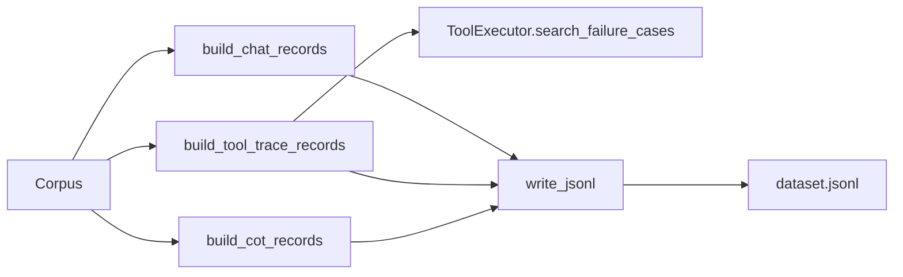

# Fine-tune exports

Active contributors: DK

## Purpose

`src/purestrata/export/finetune.py` turns a corpus into training data in three formats: `chat` messages, `tool_trace` tool-use transcripts, and `cot` instruction/reasoning/output records. Because the corpus that serves live retrieval also produces the datasets, the two cannot drift apart. Every record carries the source record's provenance, so dataset quality is auditable back to the source document.

## Key abstractions

| Abstraction | File | Notes |
| --- | --- | --- |
| `build_chat_records` | `src/purestrata/export/finetune.py` | System/user/assistant messages from `failure_case`, `procedure`, and `safety_notice` chunks |
| `build_tool_trace_records` | `src/purestrata/export/finetune.py` | Messages that include a model tool call, its result, and a grounded answer |
| `build_cot_records` | `src/purestrata/export/finetune.py` | `instruction`, `reasoning`, `output`, `sources` for expert review |
| `write_jsonl` | `src/purestrata/export/finetune.py` | Writes records as JSONL, creating parent directories |
| `ToolExecutor` | `src/purestrata/tools/executor.py` | Executes the real `search_failure_cases` call used by tool-trace records |
| `Corpus` | `src/purestrata/corpus.py` | Source of the chunks each builder iterates over |

## How it works

All three builders take a `Corpus` and an optional `limit`, and return a list of dicts. `write_jsonl` serializes any of them.



### chat

`build_chat_records` filters by kind and builds a different message pair for each:

- `failure_case` → `_failure_question` asks what the likely cause and countermeasure are, naming the equipment and symptom from metadata; `_failure_answer` answers with `Involved part:`, `Likely cause:`, `Countermeasure:`, `Severity:` lines and a `Source:` line.
- `procedure` → `_procedure_qa` returns `None` when `metadata["steps"]` is empty; otherwise the user asks to list the steps of the named procedure and the answer is a numbered list.
- `safety_notice` → `_safety_qa` returns `None` for empty text; the answer is the notice text plus its source.

Every record uses the same `SYSTEM_PROMPT` (a manufacturing maintenance assistant that cites source locators) and carries a `sources` list built by `_sources`, which serializes `chunk.provenance.to_dict()`.

### tool_trace

`build_tool_trace_records` iterates `corpus.by_kind(FAILURE_CASE)`. For each chunk it takes the query from `metadata["symptom"]`, falling back to `metadata["cause"]` then to the first 120 characters of text, and calls the real executor:

```
executor.execute("search_failure_cases", {"query": symptom, "top_k": 3})
```

`ToolError` skips the record. The resulting message list is `system`, `user`, `assistant` (with `content: null` and one `tool_calls` entry whose `id` is `call_0001`-style, `function.name` is `search_failure_cases`, and `function.arguments` is a JSON string), `tool` (with `tool_call_id` and the tool result serialized as JSON), then `assistant` with the grounded `_failure_answer` text. The tool result carries the provenance-tagged records the answer drew on, so the trace stays auditable.

### cot

`build_cot_records` emits `instruction` (the failure question), `reasoning`, `output` (`_failure_answer`), and `sources`. The reasoning is a fixed scaffold over the record's structured fields: equipment, observed symptom, the matching case id (`metadata["case_id"]` or the chunk id), recorded root cause, and applied countermeasure, closing with the inference that the same cause and countermeasure apply. It is a transparent draft meant to be reviewed and sharpened by maintenance engineers before training.

## Integration points

- CLI: `purestrata export {chat,tool_trace,cot} --corpus <dir> --out <file> [--limit N]` dispatches to these builders in `src/purestrata/cli.py` (`_run_export`).
- Python: the builders are re-exported from `src/purestrata/__init__.py`, so `from purestrata import build_cot_records, write_jsonl` works.
- The tool-trace builder depends on the tool layer, so any change to `search_failure_cases` output shape changes the training data. See [LLM tools](llm-tools.md).

## Entry points for modification

- Add a record shape: add a builder in `src/purestrata/export/finetune.py` and register it in the `builders` dict in `_run_export` (`src/purestrata/cli.py`).
- Change question or answer phrasing: the private helpers `_failure_question`, `_failure_answer`, `_procedure_qa`, `_safety_qa`, and `_sources` are the only places to touch.
- Change the system prompt: `SYSTEM_PROMPT` in `src/purestrata/export/finetune.py`.
- Add a new source kind to chat exports: extend the kind checks inside `build_chat_records`.

## Key source files

| File | Role |
| --- | --- |
| `src/purestrata/export/finetune.py` | All three builders, helpers, `SYSTEM_PROMPT`, `write_jsonl` |
| `src/purestrata/tools/executor.py` | `ToolExecutor.execute`, `ToolError`, provenance-tagged results |
| `src/purestrata/corpus.py` | `Corpus`, `by_kind`, iteration over chunks |
| `src/purestrata/types.py` | `FAILURE_CASE`, `PROCEDURE`, `SAFETY_NOTICE`, `Provenance.to_dict` |
| `src/purestrata/cli.py` | `export` subcommand and the `--limit` flag |
| `tests/test_export.py` | Shape, grounding, limit, and JSONL round-trip tests |

Related: [Corpus](../primitives/corpus.md), [Records and provenance](../primitives/records-and-provenance.md), [LLM tools](llm-tools.md), [CLI](cli.md).
