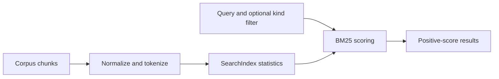

# Full-text search

Active contributors: DK

## Purpose

PureStrata's search layer ranks corpus chunks with dependency-free Okapi BM25. It tokenizes Latin and CJK text using only the Python standard library, so Japanese queries work without MeCab or a native extension.

## Key abstractions

| Abstraction | File | Notes |
| --- | --- | --- |
| `tokenize`, `has_cjk` | `src/purestrata/search.py` | NFKC/casefold tokenization and CJK detection |
| `SearchIndex` | `src/purestrata/search.py` | Stores document token counts and ranks chunks |
| `K1`, `B`, `_STOPWORDS` | `src/purestrata/search.py` | BM25 parameters and Latin token exclusions |
| `Corpus.index`, `Corpus.search` | `src/purestrata/corpus.py` | Lazy index cache and public search delegation |
| `Chunk`, `ALL_KINDS` | `src/purestrata/types.py` | Searchable records and accepted record kinds |

## How it works

### Tokenization

`tokenize` first applies Unicode NFKC normalization and `casefold`. ASCII letters, digits, and underscores form Latin tokens; tokens found in `_STOPWORDS` are dropped. The configured stopword set contains common English words and Japanese terms. CJK runs are processed separately by the CJK matcher and emitted as single-character tokens or bigrams.

The CJK matcher finds runs in Hiragana, Katakana, and Han ranges. A single-character run remains one token; each longer run becomes overlapping two-character bigrams. For example, a run `停止時間` yields `停止`, `止時`, and `時間`. Overlap lets a query share tokens with a longer Japanese word or phrase without language-specific segmentation libraries. `has_cjk` checks whether a string contains a character in the same CJK ranges.

### Index and ranking

`SearchIndex` tokenizes each chunk's `text` once at construction. It stores token counts and document lengths, computes average document length, and builds document frequency by counting each token at most once per chunk. Metadata is not included in indexed text.

For each query token present in a chunk, `_score` adds its Okapi BM25 contribution:

`idf × (tf × (K1 + 1)) / (tf + K1 × (1 - B + B × doc_len / avgdl))`

Here `tf` is the token frequency in that chunk, `df` is the number of chunks containing the token, and `N` is the number of chunks. The implementation uses `K1 = 1.5`, `B = 0.75`, and `idf = ln(1 + (N - df + 0.5) / (df + 0.5))`.

`SearchIndex.search` accepts one kind or a tuple/list of kinds, returns no results for an empty tokenized query, skips disallowed kinds and kinds outside `ALL_KINDS`, and drops scores that are zero. Remaining `(Chunk, score)` pairs are sorted by descending score and truncated to `top_k`.

`Corpus` keeps its chunks in memory and starts with `_index = None`. The first access to `Corpus.index` creates a `SearchIndex`; later `Corpus.search` calls reuse that cached index. See [Corpus](../primitives/corpus.md) for loading and storing the portable records.

## Integration points

- `Corpus.search(query, kinds=None, top_k=5)` is the corpus-level Python API; the CLI search command delegates to the same index.
- Tool handlers use corpus search to retrieve matching record kinds; [LLM tools](llm-tools.md) describes those query contracts.
- `tests/test_search.py` covers Latin stopwords, Japanese bigrams, CJK detection, kind filters, and empty matches.

## Entry points for modification

- Change the token patterns or normalization in `tokenize` and its regex constants in `src/purestrata/search.py`.
- Tune the BM25 constants `K1` and `B`, or the score terms in `_score`; validate retrieval with `tests/test_search.py`.
- Change allowed record-kind behavior in `SearchIndex.search` alongside `ALL_KINDS` in `src/purestrata/types.py`.
- Change index construction or caching in `Corpus.index` in `src/purestrata/corpus.py`.

## Key source files

| File | Role |
| --- | --- |
| `src/purestrata/search.py` | Tokenizer, CJK detector, BM25 index, and kind filtering |
| `src/purestrata/corpus.py` | Lazy index property and public search API |
| `src/purestrata/types.py` | Chunk fields and valid kinds |
| `tests/test_search.py` | Tokenization, CJK, ranking, and kind-filter coverage |

Related: [Corpus](../primitives/corpus.md), [LLM tools](llm-tools.md).
