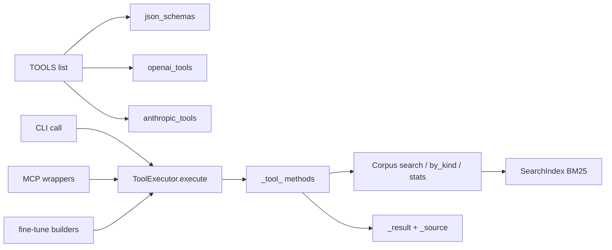

# LLM tools

Active contributors: DK

## Purpose

PureStrata defines ten tools for LLM function calling and implements all of them once, in `ToolExecutor` (`src/purestrata/tools/executor.py`). The MCP server, the CLI, the Python API, and the fine-tune exporters all call that one executor, so no surface can drift from the others. Every result is a JSON-serializable dict that embeds the record's provenance, so a model's answer can be audited back to a source file and locator.

## Key abstractions

| Abstraction | File | Notes |
| --- | --- | --- |
| `ToolSpec` / `TOOLS` / `tool_by_name` | `src/purestrata/tools/schemas.py` | Frozen dataclass (`name`, `description`, `parameters`), the ten-tool list, name lookup |
| `json_schemas` | `src/purestrata/tools/schemas.py` | Provider-neutral `{name, description, parameters}` dicts |
| `openai_tools` | `src/purestrata/tools/schemas.py` | `{"type": "function", "function": ...}`, for OpenAI, xAI Grok, and OpenAI-compatible endpoints |
| `anthropic_tools` | `src/purestrata/tools/schemas.py` | `{name, description, input_schema}` |
| `ToolExecutor` / `ToolError` | `src/purestrata/tools/executor.py` | Dispatch and behavior; invalid calls raise `ToolError` |
| `_result` / `_source` | `src/purestrata/tools/executor.py` | Result envelope with chunk fields, provenance, optional rounded `score` |
| `feature_diameter_mm` | `src/purestrata/ingest/geometry.py` | Millimetre diameter when units are known, native units otherwise; drives `search_drawings` |
| `Corpus` | `src/purestrata/corpus.py` | `search` (BM25), `by_kind`, `stats`, `get` |

## How it works

Schemas and execution are separate. Each tool is one `ToolSpec` in the `TOOLS` list in `src/purestrata/tools/schemas.py`. The shared `_TOP_K_PARAM` declares `top_k` as an integer from 1 to 50, default 5, with the default overridden to 10 for `get_safety_notices`, `search_parts`, and `search_drawings`. Three renderers reshape the same list for provider APIs:

- `json_schemas()`: `{name, description, parameters}` per tool.
- `openai_tools()`: wraps each in `{"type": "function", "function": {...}}`.
- `anthropic_tools()`: renames `parameters` to `input_schema`.

`ToolExecutor.execute(name, args)` first resolves the name through `tool_by_name` (an unknown name raises `ToolError` with `Unknown tool: ...`), then looks up the handler with `getattr(self, f"_tool_{name}")`. A schema without a matching handler raises `ToolError` with `Tool is defined but not implemented: ...` instead of failing silently. That guard keeps `TOOLS` and the `_tool_*` methods in sync.

Argument validation lives in three helpers in `src/purestrata/tools/executor.py`:

- `_clamp_top_k(value, default)`: `int(value)`, falling back to `default` on `TypeError`/`ValueError`, then clamped to the range 1 to 50.
- `_as_str(value)`: stripped `str(value)`, or `""` for `None`.
- `_as_float(value, name)`: `None` and `""` become `None`; anything non-numeric raises `ToolError` with `'<name>' must be a number.`.

`_source(chunk)` returns `chunk.provenance.to_dict()`, the `doc_id`, `source_path`, and `locator` triple from `src/purestrata/types.py`. `_result(chunk, score=None)` wraps `chunk_id`, `kind`, `text`, `metadata`, and `source`, and adds `score` rounded to three decimals when the record came from BM25 ranking. `_find_by_id(value, kind=None)` casefolds the needle and scans `corpus.chunks` for a `chunk_id` match first, then makes a second pass over `metadata["case_id"]` and `metadata["drawing_id"]`. All comparisons are case-insensitive, an optional kind must also match (a `chunk_id` hit with the wrong kind is skipped), and no hit raises `ToolError`.

### The ten tools

| Tool | Required | Behavior |
| --- | --- | --- |
| `list_corpus` | | `Corpus.stats()`: total records, counts by kind, document ids |
| `search_documents` | `query` | BM25 over all records; optional `kind` chosen from `ALL_KINDS`; `top_k` default 5 |
| `get_safety_notices` | | `safety_notice` records, ranked with scores when `query` is given, otherwise unranked |
| `get_procedure` | `procedure_id` | `_find_by_id` restricted to `procedure`; returns the chunk with `metadata["steps"]` |
| `search_parts` | | `part_record` records, ranked when `query` is given, otherwise unranked |
| `list_drawings` | | Summary row per `drawing` chunk: `drawing_id`, `chunk_id`, `cad_format`, `file_name`, `units`, `title_block`, `source` |
| `get_drawing` | `drawing_id` | `_find_by_id` restricted to `drawing`; accepts the drawing number or the chunk id |
| `search_drawings` | | Geometry and attribute filters over drawings, detailed below |
| `search_failure_cases` | `query` or `equipment` | BM25 over `failure_case` records with an equipment prefilter, detailed below |
| `get_failure_case` | `case_id` | `_find_by_id` restricted to `failure_case` |

### search_drawings

`top_k` defaults to 10. Filters run against metadata that the DXF and STEP adapters attach to `drawing` chunks (see [CAD ingestion](cad-ingestion/index.md)), and the result set is truncated only after filtering.

- Diameter range: with `min_diameter` or `max_diameter` set, every entry in `metadata["circular_features"]` is tested with `feature_diameter_mm`, which prefers `diameter_mm` (normalized to millimetres at ingest time) and falls back to the native-unit `diameter` when the drawing's units are unknown. Surviving features are echoed per result as `matched_features`; a drawing with none is dropped. `min_diameter` greater than `max_diameter` raises `ToolError`.
- Fit: compared exactly and case-sensitively against `diameter_callouts[].fit`, so `H7` matches and `h7` does not. Matches are echoed as `matched_callouts`; a drawing with none is dropped.
- Material: case-insensitive substring test against `title_block.material`, falling back to the whole chunk text when the title block has no material.
- `cad_format`: exact match against `metadata["format"]`, which defaults to `"dxf"` when absent, so `cad_format: "step"` selects STEP models.
- Query: optional. With a query, BM25 ranks the drawing kind first (`top_k` is set to the full drawing count, so ranking never drops a candidate before the filters run) and surviving results carry a rounded `score`.
- The response echoes the active filters in `filters` alongside `results`.

### search_failure_cases

`query` or `equipment` is required, otherwise `ToolError`. `equipment` prefilters `failure_case` candidates with a case-insensitive substring test on `metadata["equipment"]`. With a query, BM25 ranks all failure cases and the ranked list is intersected with the equipment candidates by `chunk_id`; the top `top_k` (default 5) come back with scores. When the ranked intersection is empty but candidates exist, the tool falls back to the unranked candidates, so filtering by equipment alone still returns that equipment's records, without scores.

### Tests

`test_ten_tools_defined` in `tests/test_tools.py` pins the count at ten for both `TOOLS` and `openai_tools()`. The rest of the file exercises behavior: results carry `source.source_path` and `source.locator`; `H7` matches a callout while `h7` returns nothing; the diameter range spans DXF and STEP drawings; `min_diameter: "wide"` and an inverted range raise `ToolError`; the equipment filter keeps only matching records; unknown tools, missing ids, and empty queries raise. `tests/test_ingest_cad.py` pins the drawing metadata these tools read: title block fields such as `dwg_no` and `material`, `entity_counts`, the `BORE DIA 25 H7` text annotation, and geometric bounds.

## Integration points

- Python API: `ToolExecutor`, `ToolError`, `TOOLS`, and the three renderers are re-exported from `src/purestrata/__init__.py` via `src/purestrata/tools/__init__.py`.
- MCP: one wrapper per tool in `src/purestrata/mcp_server.py` ([MCP server](mcp-server.md)).
- CLI: `purestrata tools <format>` prints a renderer's output and `purestrata call` runs the executor locally ([CLI](cli.md)).
- Exports: `build_tool_trace_records` in `src/purestrata/export/finetune.py` records a real `search_failure_cases` call, so changing that tool changes the training data ([Fine-tune exports](fine-tune-exports.md)).

## Entry points for modification

- Add a tool: append a `ToolSpec` in `src/purestrata/tools/schemas.py` and a `_tool_<name>` method in `src/purestrata/tools/executor.py`, then update `test_ten_tools_defined` in `tests/test_tools.py`. The MCP wrapper ([MCP server](mcp-server.md)) is the only other registration point.
- Add a `search_drawings` filter: extend `_tool_search_drawings` and its `filters` echo in `src/purestrata/tools/executor.py`.
- Change the result shape: `_result` is the single place; every surface and the exporters inherit the change.

## Key source files

| File | Role |
| --- | --- |
| `src/purestrata/tools/schemas.py` | `ToolSpec`, `TOOLS`, the three renderers |
| `src/purestrata/tools/executor.py` | `ToolExecutor`, `ToolError`, helpers, envelopes, all ten `_tool_*` methods |
| `src/purestrata/tools/__init__.py` | Re-exports consumed by `src/purestrata/__init__.py` |
| `src/purestrata/ingest/geometry.py` | `feature_diameter_mm` and callout parsing behind the drawing filters |
| `src/purestrata/corpus.py` | `Corpus.search`, `by_kind`, `stats` |
| `src/purestrata/types.py` | `Chunk`, `Provenance.to_dict`, kind constants |
| `tests/test_tools.py` | Tool behavior, ten-tool count, filter edge cases |
| `tests/test_ingest_cad.py` | Drawing metadata that the drawing tools filter on |

Related: [Full-text search](full-text-search.md), [Records and provenance](../primitives/records-and-provenance.md), [Patterns and conventions](../how-to-contribute/patterns-and-conventions.md).
