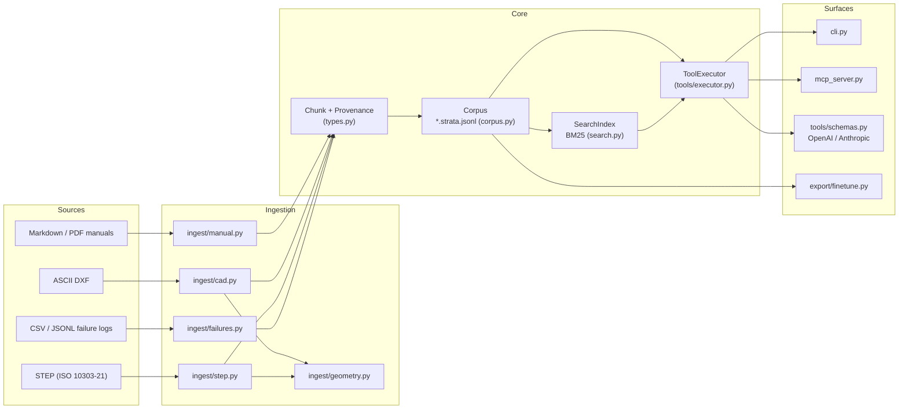

# Architecture

PureStrata is a single Python package with a deliberately flat architecture: ingest adapters turn source documents into typed records, the records live in a directory of portable JSONL files, and one tool executor serves every query surface. There is no server to run (except the optional MCP stdio server), no database, and no required dependency.

## Data flow

Ingestion is a one-way street: adapters read a source file and emit a list of `Chunk` objects (`src/purestrata/types.py`). Each chunk is written as one JSON line to `<doc_id>.strata.jsonl` in the corpus directory (`src/purestrata/corpus.py`). Loading a corpus reads every `*.strata.jsonl` file into memory, lazily builds a BM25 index (`src/purestrata/search.py`), and hands both to `ToolExecutor` (`src/purestrata/tools/executor.py`), which implements the ten tools as `_tool_<name>` methods. Every surface calls the same executor:

| Surface | Entry point | Notes |
| --- | --- | --- |
| CLI | `src/purestrata/cli.py` | `ingest-*`, `search`, `inspect`, `tools`, `export`, `call`, `serve` |
| MCP server | `src/purestrata/mcp_server.py` | stdio JSON-RPC, requires the `mcp` extra |
| LLM tool schemas | `src/purestrata/tools/schemas.py` | Same specs rendered as raw JSON Schema, OpenAI function definitions, and Anthropic definitions |
| Python API | `src/purestrata/__init__.py` | `ToolExecutor(Corpus.load(...)).execute(name, args)` |

Fine-tuning exports (`src/purestrata/export/finetune.py`) read the same corpus and emit chat, tool-trace, and CoT records, so training data and live retrieval never drift apart.

## Components

| Component | Files | Responsibility |
| --- | --- | --- |
| Data model | `src/purestrata/types.py` | `Chunk`, `Provenance`, kind constants, deterministic chunk ids, schema version |
| Corpus storage | `src/purestrata/corpus.py` | Read/write `*.strata.jsonl`, corpus stats, kind-filtered access |
| Search | `src/purestrata/search.py` | Okapi BM25 with Latin word tokens and CJK character bigrams |
| Text pipeline | `src/purestrata/pipeline/clean.py`, `src/purestrata/pipeline/chunk.py` | Whitespace normalization, PDF dehyphenation, sentence-aware chunk splitting with overlap |
| Manual adapter | `src/purestrata/ingest/manual.py` | Markdown and PDF structure: sections, procedures, safety notices, parts tables |
| CAD adapters | `src/purestrata/ingest/cad.py`, `src/purestrata/ingest/step.py`, `src/purestrata/ingest/geometry.py` | DXF pair parsing, STEP Part 21 parsing, shared geometry summaries |
| Failure adapter | `src/purestrata/ingest/failures.py` | Flexible-column CSV/JSONL to `failure_case` records |
| Tools | `src/purestrata/tools/schemas.py`, `src/purestrata/tools/executor.py` | Tool specs and the single local implementation |
| MCP server | `src/purestrata/mcp_server.py` | Binds the executor to MCP clients over stdio |
| Fine-tune export | `src/purestrata/export/finetune.py` | chat / tool_trace / CoT dataset builders |

## Size and language

All application code is Python. As of 2026-10-10: `src/purestrata` is 2,868 lines across 20 files, tests are 913 lines across 11 files, and the test suite runs in under a second. There is no frontend and no generated code. See [By the numbers](../by-the-numbers.md) for the full statistics.

## Design principles

1. **Provenance on every record.** Every chunk stores `doc_id`, `source_path`, and `locator`; every tool result embeds them. See [Records and provenance](../primitives/records-and-provenance.md).
2. **Zero required dependencies.** The core parsers, BM25 search, and tool executor use only the standard library, so the package installs anywhere, including air-gapped machines. `pypdf` and `mcp` are optional extras.
3. **One executor, many surfaces.** MCP, OpenAI-style tool calling, Anthropic definitions, Python, and the CLI all run through `ToolExecutor`, so behavior cannot diverge between integrations.
4. **Plain files over infrastructure.** A corpus is a directory of JSONL you own: copy it, commit it, ship it. No database, no service daemon, no lock-in.
5. **Troubleshooting first.** `search_failure_cases` is positioned as the first tool for equipment problems; failure knowledge is a first-class record kind, not manual text to be scraped.
