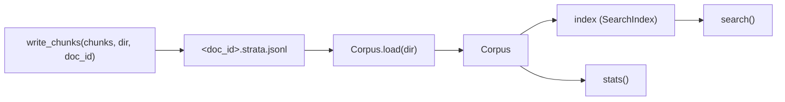

# Corpus

Active contributors: DK

## Purpose

`src/purestrata/corpus.py` is the storage and access layer for a corpus: a directory of `*.strata.jsonl` files, one per ingested document, one JSON object per line. There is no database and no daemon, so a corpus is a plain set of files you can commit to git, copy to a file share, or carry into an air-gapped network. The module also gives that directory an in-memory API: statistics, kind-filtered access, and search through the shared index.

## Key abstractions

| Abstraction | File | Notes |
| --- | --- | --- |
| `CORPUS_SUFFIX` | `src/purestrata/corpus.py` | The string `.strata.jsonl`; every corpus file ends with it |
| `write_chunks` | `src/purestrata/corpus.py` | Writes one `<doc_id>.strata.jsonl` for an ingested document |
| `Corpus` | `src/purestrata/corpus.py` | In-memory view of a corpus directory |
| `Corpus.load` | `src/purestrata/corpus.py` | Reads every `*.strata.jsonl` file under a directory |
| `Corpus.index` | `src/purestrata/corpus.py` | Lazily built `SearchIndex` (`src/purestrata/search.py`) |
| `Corpus.stats` | `src/purestrata/corpus.py` | `total_chunks`, `by_kind`, `documents` |
| `Corpus.search` / `Corpus.get` / `Corpus.by_kind` | `src/purestrata/corpus.py` | Query, id lookup, and kind filtering |

## How it works

### Writing

`write_chunks(chunks, out_dir, doc_id)` creates `out_dir` (including parents) if needed and opens `<out_dir>/<doc_id>.strata.jsonl` for writing in UTF-8. Each chunk is written as `json.dumps(chunk.to_dict(), ensure_ascii=False)` followed by a newline, so Japanese text stays readable in the file rather than being escaped. It returns the output path. Opening in `"w"` mode means re-ingesting a document overwrites its file, which is what makes ingestion idempotent when paired with deterministic chunk ids ([Records and provenance](records-and-provenance.md)).

### Loading

`Corpus.load(corpus_dir)` is a classmethod. It raises `FileNotFoundError("Corpus directory not found: <dir>")` when the directory is missing. Otherwise it iterates `sorted(corpus_dir.glob("*.strata.jsonl"))` so file order is stable, splits each file on newlines, skips blank lines, and parses every remaining line with `json.loads` into `Chunk.from_dict`. A foreign schema prefix raises `ValueError` at load time, so an incompatible file fails loudly instead of being loaded with missing fields. Glob is not recursive: only files directly in the directory are read.

### In-memory access

`Corpus.__init__` copies the chunk list and leaves the index unset. `index` is a property that builds `SearchIndex(self.chunks)` on first access and caches it, so a caller that only needs `stats` never pays for indexing. `search(query, kinds=None, top_k=5)` delegates to the index and returns `(Chunk, score)` pairs. `get(chunk_id)` does a linear scan and returns the first chunk with a matching id or `None`. `by_kind(*kinds)` returns every chunk whose kind is in the given set.

`stats()` returns a dict with three keys:

- `total_chunks`: the number of loaded chunks.
- `by_kind`: counts for the kinds that are present, in `ALL_KINDS` order; kinds with zero records are omitted.
- `documents`: a sorted list of the distinct `provenance.doc_id` values.

### Portability

Because every file is line-oriented JSON, a corpus can be inspected with ordinary tools (`grep`, `jq`) without the library. The trade-off is that `load` reads whole files into memory, which is fine for maintenance-scale corpora and would need streaming for very large ones.

## Integration points

- Ingest adapters hand their `Chunk` lists to `write_chunks`; the CLI's `ingest-*` commands do this after reading a source file (`src/purestrata/cli.py`).
- `ToolExecutor` is constructed with a `Corpus` and uses `search`, `get`, and `by_kind` (`src/purestrata/tools/executor.py`).
- The CLI's `search` and `inspect` commands call `Corpus.load` then `search` or `stats` (`src/purestrata/cli.py`).
- The MCP server loads a corpus at startup and serves it over stdio (`src/purestrata/mcp_server.py`).
- Fine-tuning builders iterate `corpus.chunks` and `corpus.by_kind` ([Fine-tune exports](../features/fine-tune-exports.md)).

## Entry points for modification

- Change the on-disk suffix: `CORPUS_SUFFIX` in `src/purestrata/corpus.py`. Everything that reads a corpus derives from it, but existing directories would need renaming.
- Change the file naming scheme: `write_chunks` in `src/purestrata/corpus.py`; keep one file per document so idempotent overwrite holds.
- Add statistics: `Corpus.stats` in `src/purestrata/corpus.py`. Keep the `ALL_KINDS` ordering for `by_kind`.
- Add an accessor: new methods on `Corpus` in `src/purestrata/corpus.py`; tools should still go through the executor rather than calling the corpus directly.

## Key source files

| File | Role |
| --- | --- |
| `src/purestrata/corpus.py` | `CORPUS_SUFFIX`, `write_chunks`, `Corpus` |
| `src/purestrata/types.py` | `Chunk.to_dict`/`from_dict`, `ALL_KINDS`, `Provenance` |
| `src/purestrata/search.py` | `SearchIndex`, built lazily by `Corpus.index` |
| `src/purestrata/cli.py` | `search` and `inspect` commands over a loaded corpus |
| `tests/test_corpus.py` | Round-trip, stats, idempotent re-ingestion, missing directory, foreign schema |

Related: [Records and provenance](records-and-provenance.md), [Full-text search](../features/full-text-search.md), [CLI](../features/cli.md), [Reference: data models](../reference/data-models.md).
