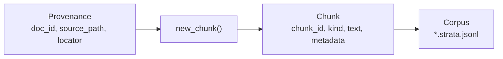

# Primitives

The foundational objects every other module in PureStrata references: a `Chunk` (typed, searchable text with metadata), its `Provenance` (source file plus locator), the six-kind taxonomy that classifies records, and the `Corpus` that stores and loads them. Ingest adapters produce these objects, search and tools consume them, and fine-tuning exports read from the same corpus.

## Pages

| Page | What it covers |
| --- | --- |
| [Records and provenance](records-and-provenance.md) | `src/purestrata/types.py`: the six kind constants and `ALL_KINDS`, `derive_doc_id`, `make_chunk_id`, the `Provenance` and `Chunk` dataclasses, and `new_chunk` |
| [Corpus](corpus.md) | `src/purestrata/corpus.py`: writing `<doc_id>.strata.jsonl` files, loading a corpus directory, the lazy search index, `stats`, `search`, `get`, and `by_kind` |

## The kinds

Records are classified by six string constants defined in `src/purestrata/types.py` and listed in `ALL_KINDS`:

| Constant | Value | Produced by |
| --- | --- | --- |
| `MANUAL_SECTION` | `manual_section` | `src/purestrata/ingest/manual.py` |
| `SAFETY_NOTICE` | `safety_notice` | `src/purestrata/ingest/manual.py` |
| `PROCEDURE` | `procedure` | `src/purestrata/ingest/manual.py` |
| `PART_RECORD` | `part_record` | `src/purestrata/ingest/manual.py` |
| `DRAWING` | `drawing` | `src/purestrata/ingest/cad.py`, `src/purestrata/ingest/step.py` |
| `FAILURE_CASE` | `failure_case` | `src/purestrata/ingest/failures.py` |

`ALL_KINDS` fixes the order used wherever kinds are enumerated, such as corpus statistics, so no module keeps a second list.

## How they fit together

`new_chunk` is the only constructor callers should use: it derives the deterministic `chunk_id` from the kind and locator, so re-ingesting an unchanged file overwrites the same ids instead of duplicating records. See [Records and provenance](records-and-provenance.md) for the id scheme and [Corpus](corpus.md) for storage and loading.

## Invariants

These hold for every record in every corpus and are enforced or assumed throughout the codebase:

| Invariant | Enforced by |
| --- | --- |
| Every chunk carries a `Provenance` with a non-empty, human-readable locator | `src/purestrata/types.py`; convention in [Patterns and conventions](../how-to-contribute/patterns-and-conventions.md) |
| Chunk ids are deterministic, so re-ingesting an unchanged file is idempotent | `make_chunk_id`, `new_chunk` (`src/purestrata/types.py`) |
| Serialized records carry `"schema": "purestrata/v1"`; foreign prefixes are rejected | `Chunk.to_dict`, `Chunk.from_dict` (`src/purestrata/types.py`) |
| Kinds are imported constants, never repeated string literals | `src/purestrata/types.py` and every consumer |
| `metadata` is a JSON-serializable dict; `text` is the human-readable searchable field | Convention; tools filter on `metadata` and rank on `text` |
| `new_chunk` is the only constructor callers use | Convention; adapters follow it |

## How a record flows

1. An adapter reads a source file and calls `new_chunk` for each record it finds.
2. The adapter's caller writes the records with `write_chunks`, producing one `<doc_id>.strata.jsonl` file per document.
3. `Corpus.load` reads the directory and reconstructs the chunks, validating the schema marker.
4. Search, tools, the CLI, the MCP server, and the export builders all read from that `Corpus`.

## Where the primitives are used

- Ingest adapters build chunks: [Manual ingestion](../features/manual-ingestion.md), [CAD ingestion](../features/cad-ingestion/index.md), [Failure knowledge](../features/failure-knowledge.md).
- Search reads `chunk.text` and `chunk.kind`: [Full-text search](../features/full-text-search.md).
- Tools filter on `chunk.metadata` and return provenance: [LLM tools](../features/llm-tools.md).
- Exports serialize provenance into every training record: [Fine-tune exports](../features/fine-tune-exports.md).
- Conventions that govern all of the above: [Patterns and conventions](../how-to-contribute/patterns-and-conventions.md).
- Field-level reference: [Reference: data models](../reference/data-models.md).
